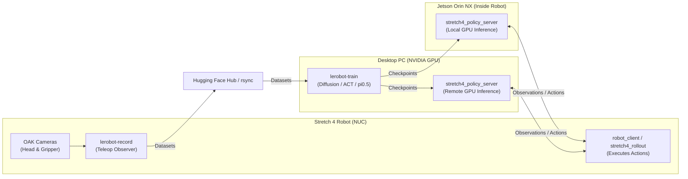

# stretch4_lerobot

Teach the Hello Robot **Stretch 4** a task with [LeRobot](https://github.com/huggingface/lerobot):
record demonstrations on the robot, train a policy on a desktop GPU, and run it on the robot.

Works with stock LeRobot commands (`lerobot-record`, `lerobot-train`, async inference) and standard LeRobot policies without code changes to LeRobot.

---

## System Architecture



---

## Supported Policies & Requirements

| Policy | `--policy.type` | Tested on Stretch 4 | Runs on the Jetson |
|---|---|---|---|
| **Diffusion** | `diffusion` | Yes | Yes |
| **pi0.5 (LoRA)** | `pi05` | Yes | No (run on a desktop GPU) |
| **ACT** | `act` | Yes | Yes |
| **Other LeRobot policies** | See LeRobot docs | Untested | Depends on policy architecture |

| Machine | Used For | Requirements |
|---|---|---|
| **Robot** (Stretch 4) | Recording demonstrations and executing policy actions | `stretch4_body`, Python 3.12, LeRobot 0.6 |
| **Desktop** with NVIDIA GPU | Training policies, and running remote policy server | Python 3.12, LeRobot 0.6, CUDA |
| **Jetson** (inside Stretch 4, optional) | Running onboard policy server | JetPack 6.2, Python 3.10 (configured via `tools/setup_jetson.sh`) |

Also required: a teleop device for recording (see [Teleoperation](#teleoperation)), and an optional [Hugging Face](https://huggingface.co) account for dataset transfer. Tested with **LeRobot 0.6.1**.

---

## Quick Installation

Run this on the **Stretch 4** robot:

```bash
cd ~/repos
git clone https://github.com/hello-robot/stretch4_lerobot.git
cd stretch4_lerobot

python3 -m venv --system-site-packages .venv
source .venv/bin/activate
pip install "lerobot[dataset,training,deepdiff-dep,async]==0.6.*"
pip install -e packages/lerobot_camera_oak \
            -e packages/lerobot_robot_stretch4 \
            -e packages/lerobot_teleoperator_stretch4

# Verify installation
python -c "import stretch4_body, depthai, lerobot, lerobot_robot_stretch4; print('Ready!')"
```

---

## Teleoperation

Demonstrations are recorded while you drive the robot with a teleop device, run as its own process alongside `lerobot-record` (see [Collecting and Preparing Data](docs/1-collecting-and-preparing-data.md)). Each device suits a different kind of task, so pick the one that matches the motions in your demonstrations:

| Device | Best suited for | Keep in mind | How to run it |
|---|---|---|---|
| **Gamepad** | Getting started quickly with no extra hardware; precise, one-joint-at-a-time control | Joints are commanded separately, so motions that need the base and wrist to move together (e.g. opening a fridge door) take more practice | Run `stretch_gamepad_teleop` on the robot |
| **Stretch Dex Teleop** | Tasks that coordinate wrist rotation with base rotation | Designed for a stationary setup: the base rotates in place rather than driving around | See [stretch4_dex_teleop](https://github.com/hello-robot/stretch4_dex_teleop.git) |
| **Meta Quest 3** | Natural wrist motion — the robot's wrist follows your hand (except wrist roll), with the base driven separately | The headset can get tiring during longer recording sessions | See [stretch4_quest_teleop](https://github.com/hello-robot/stretch4_quest_teleop) |
| **Puppet Teleop** | The most intuitive option: moving the puppet moves the robot the same way, so whole-body motions like coordinated base + wrist work best here | Requires a second (puppet) robot | See [Puppet Teleop primer](https://docs.hello-robot.com/stretch4-body-repo/teleoperation/primer_puppet_teleop) |

---

## Workflow Guides

Follow the three guides in order:

| Step | Machine | Purpose | Guide |
|---|---|---|---|
| **1. Collect Data** | Robot | Configure cameras, record demonstrations, prepare dataset, and push to Hub | [Collecting and Preparing Data](docs/1-collecting-and-preparing-data.md) |
| **2. Train Policy** | Desktop GPU | Set up training environment, load dataset, and train policy | [Training a Policy](docs/2-training-policy.md) |
| **3. Deploy Policy** | Jetson or Desktop GPU, and Robot | Run policy server on GPU and execute autonomous rollouts on the robot | [Deploying a Policy](docs/3-deploy-policy.md) |

---

## Packages & CLI Commands

This repository provides three pip packages in `packages/`:

- **`lerobot_robot_stretch4`**: Adds `--robot.type=stretch4` and all `stretch4_*` tools.
- **`lerobot_camera_oak`**: Adds camera `type: oak` for the head stereo pair and gripper camera.
- **`lerobot_teleoperator_stretch4`**: Adds `--teleop.type=stretch4_observer` to record with any teleop device.

LeRobot discovers packages starting with `lerobot_robot_*`, `lerobot_camera_*` and `lerobot_teleoperator_*` automatically on import.

### Command Reference

| Command | Description |
|---|---|
| `stretch4_pick_cameras` | Interactive GUI to select camera crops in native pixels; writes `cameras.json` |
| `stretch4_pose` | Save arm poses and smoothly return to them between demonstration episodes or rollouts |
| `stretch4_fix_stats` | Prepare recorded datasets for training (held joints, stats floors, relative actions) |
| `stretch4_push_dataset` | Verify, re-prepare, and upload datasets to the Hugging Face Hub |
| `stretch4_policy_server` | LeRobot's async policy server with fixes (multi-frame history, similarity filter off, LoRA loading) |
| `stretch4_rollout` | Automated multi-episode rollout client with start pose resets |
| `stretch4_say` | Spoken audio feedback using cached Stretch 4 TTS |

### Why `stretch4_policy_server` instead of stock LeRobot?

`stretch4_policy_server` uses the same protocol and flags as LeRobot's async policy server, with fixes for three bugs in LeRobot 0.6's async inference:
1. **Multi-frame observation history**: LeRobot's stock server passes only one observation frame, causing multi-frame policies (Diffusion, VQ-BeT) to crash with an empty `Error in StreamActions:`. `stretch4_policy_server` feeds past frames 1/fps apart.
2. **Similarity filter off by default**: The stock similarity filter drops observations whose joint delta is < 1.0 (tuned for degrees). Stretch 4 reports metres and radians, causing the stock server to drop valid requests and stutter. It is disabled by default (`--skip_similar_observations=true` restores it).
3. **LoRA weights loading**: The stock server runs pi0.5 LoRA checkpoints with uninitialized random weights. `stretch4_policy_server` loads the LoRA adapter onto its base model.

---

## Technical Reference: Dataset Contract & Cameras

### Dataset Columns

| Index | Column Name | Quantity | Unit | Frame |
|:---:|---|---|---|---|
| `0` | `base_vx` | Longitudinal velocity | m/s | Robot body frame |
| `1` | `base_vy` | Lateral velocity | m/s | Robot body frame |
| `2` | `base_omega` | Yaw angular velocity | rad/s | Robot body frame |
| `3` | `lift` | Carriage height | m | Absolute joint |
| `4` | `arm` | Telescoping extension | m | Absolute joint |
| `5` | `wrist_yaw` | Wrist yaw | rad | Absolute joint |
| `6` | `wrist_pitch` | Wrist pitch | rad | Absolute joint |
| `7` | `wrist_roll` | Wrist roll | rad | Absolute joint |
| `8` | `grip_mm` | Gripper opening | mm | Absolute fingertip spacing |
| `9` *(opt)* | `grip_effort` | Gripper motor effort | % (0–100) | State-only (`--robot.grip_effort=true`) |

- **State and action columns match 1-to-1** (`state[i]` and `action[i]` represent the same quantity for indices 0–8), enabling relative action policies like `pi05` (delta = action - state).
- **Action Lookahead**: In `mode="observe"`, `action[t] = state[t + N]` to account for teleop control lead. Configurable via `--robot.action_lookahead=N` when recording (default is 3). In `mode="control"`, lookahead is automatically 0.
- **Camera Frame Synchronization**: The primary camera clocks observations; accompanying frames captured within 20 ms are paired. Joint states are interpolated to the primary camera's capture time.
- **Sidecar (`meta/stretch4.json`)**: Preserves camera crops, rotations, column schemas, and data preparation options for reproducible deployment via `--robot.preprocessing_from=<dataset>`.


---

## Development & Testing

```bash
# The policy server tests need LeRobot's diffusion extra
pip install pytest "lerobot[diffusion]==0.6.*"

# Run the test suite
pytest tests
```

`pytest.ini` automatically isolates test runs from ambient ROS 2 Jazzy and `ament` plugins on Stretch robots.

The test suite pins the dataset contract (`tests/test_schema.py`), camera crop/resize math (`tests/test_oak_config.py`, `tests/test_pick_cameras.py`), 3-frame lookahead (`tests/test_lookahead.py`), camera timestamp matching (`tests/test_sync_and_guard.py`), and mock rollout execution (`tests/test_rollout.py`, `tests/test_policy_server.py`).

Contributions and pull requests should ensure all 100 tests pass and maintain the column ordering contract.

---

## License & Support

- **Issues**: Open a ticket at [hello-robot/stretch4_lerobot/issues](https://github.com/hello-robot/stretch4_lerobot/issues).
- **Architecture Deep Dive**: Read [blog/stretch4-lerobot.md](blog/stretch4-lerobot.md) for engineering design details.
- **License**: Apache License 2.0 - see [LICENSE](LICENSE). Copyright 2026 Hello Robot Inc.
